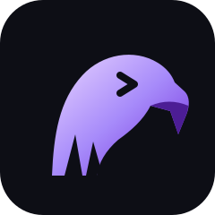
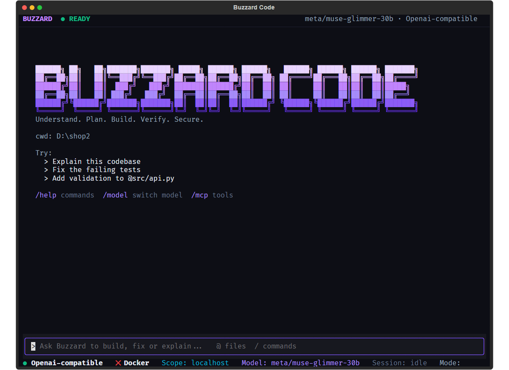
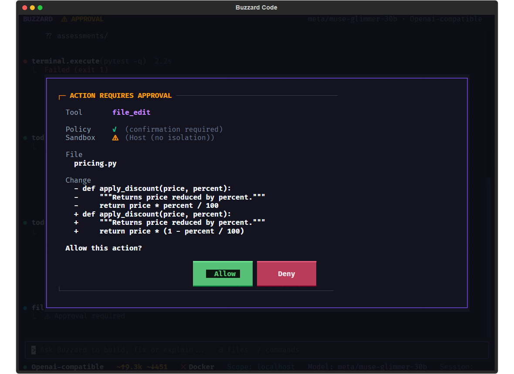
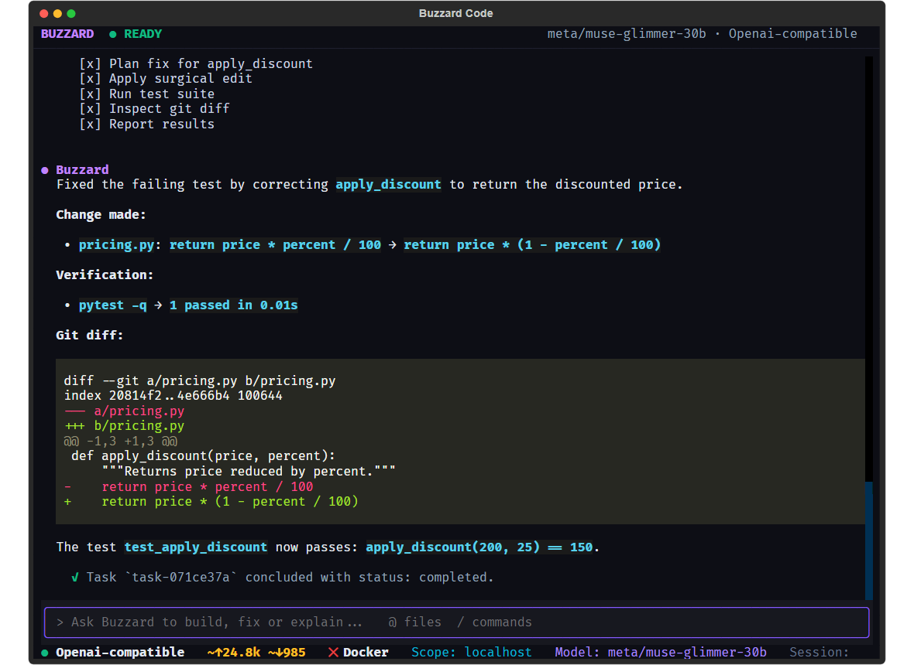
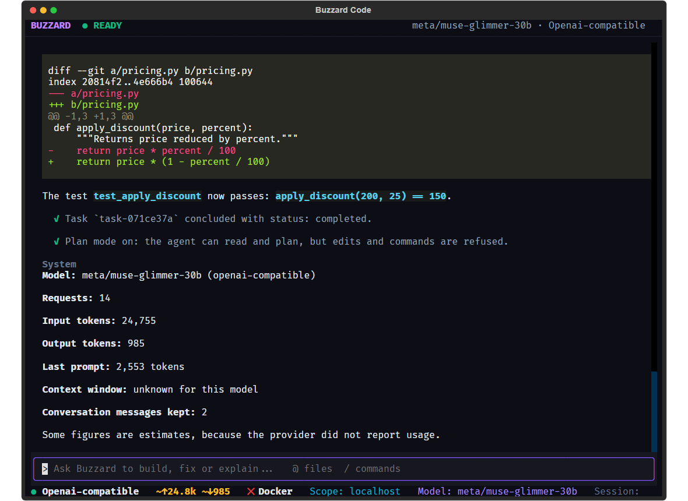
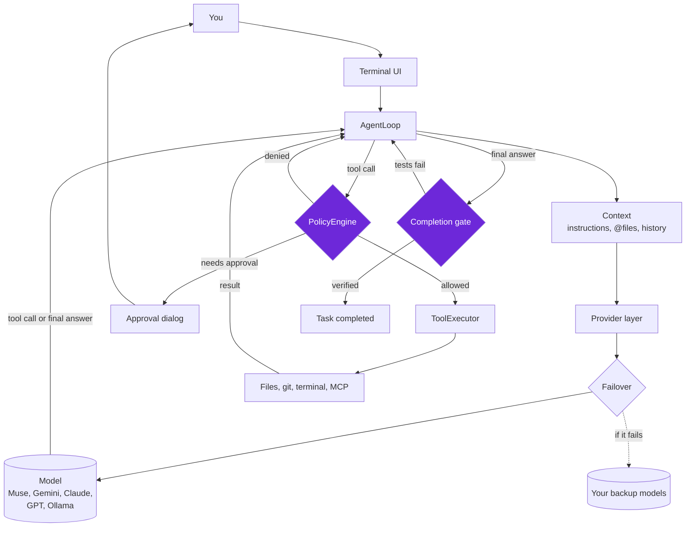

<p align="center">
  
</p>

<h1 align="center">Buzzard Code</h1>

<p align="center"><b>Understand. Plan. Build. Verify. Secure.</b></p>

<p align="center">A terminal coding agent that cannot call a task done until the code proves it.</p>

<p align="center">
  <a href="LICENSE"></a>
  
  
</p>

<p align="center"></p>

> **The model proposes. Code decides.**

## Contents

- [Why Buzzard exists](#why-buzzard-exists)
- [See it work](#see-it-work)
- [How it works](#how-it-works)
- [Architecture](#architecture)
- [Features](#features)
- [Plug and play](#plug-and-play)
- [Results on Meta models](#results-on-meta-models)
- [Quick start](#quick-start)
- [Commands](#commands)
- [Configuration](#configuration)
- [Security model](#security-model)
- [How it was built](#how-it-was-built)
- [Scope and limitations](#scope-and-limitations)
- [Roadmap](#roadmap)

## Why Buzzard exists

Coding agents write code quickly. The hard question is whether you can trust what they tell you.

An agent can say "all tests pass" when they don't. It can run a command you would have refused. It can lose track of a long task and still sound confident. When the model is both the worker and the judge of its own work, nothing independent stands between a confident sentence and your codebase.

Buzzard separates those roles:

| Decision | Who decides |
|---|---|
| What to read, change and try next | The model |
| Whether the task is really finished | The completion gate, using git and the real test suite |
| Whether an edit or command may run | You, through an approval the model cannot skip |
| What plan mode allows | Code, not a request in the prompt |

## See it work

These screenshots come from a real Muse Glimmer session in the real terminal app, on a small demo repository with a deliberate bug. The approvals were pressed by a test script rather than by hand.

**Every edit and command shows exactly what will happen before it runs.** `y` approves once, and `s` allows file edits or that exact command for the session.

<p align="center"></p>

**The task finishes only after the gate has run the tests.** The agent's summary, the diff and the token meter appear in the terminal.

<p align="center"></p>

**`/usage` shows what the session has used.** Figures marked `~` are estimates, for providers that report no usage while streaming.

<p align="center"></p>

## How it works

1. **You ask.** "Fix the failing test in `@pricing.py`." Mentioned files are attached and labelled as data, not instructions.
2. **The agent loads context.** It reads project instructions from `BUZZARD.md`, `AGENTS.md` or `CLAUDE.md`, plus earlier turns in the conversation.
3. **The model picks a tool.** It can read, search, edit, run commands and inspect git.
4. **Policy checks the call.** Kill switch, scope and risk rules run in code, then you approve or deny the exact action.
5. **The result goes back to the model.** A failing test is simply more information, and the model tries again.
6. **The model says it is done.** This is only a claim.
7. **The gate checks the claim.** It reads the real git state, checks the syntax of changed files, and runs the project's tests, which also need your approval.
8. **Pass or reject.** If it passes, the task completes. If it fails, the real test output goes back to the model and the loop continues until the turn limit, when the task is reported as failed.

Read-only requests such as "explain this codebase" skip the test gate because they change nothing.

## Architecture



The two highlighted boxes are deterministic code. The model cannot talk its way past them.

| Component | Location | Responsibility |
|---|---|---|
| Terminal UI | `tui/` | Textual app: transcript, approvals, diffs, commands, token meter |
| Agent loop | `agent/loop.py` | Runs model turns and dispatches tools; stops a model that repeats itself |
| Project context | `agent/project_context.py` | Instructions, `@file` mentions, saved conversations |
| Providers | `model/` | One interface over Meta, OpenAI-compatible hosts, Anthropic, Gemini and Ollama |
| Failover | `model/failover.py` | Moves to your next configured model when one fails |
| Tool-call conversion | `model/tool_calls.py` | Translates each provider's wire format, and repairs history so calls and results stay paired |
| Policy and approvals | `security/` | Risk classes, scope, kill switch and approval gate |
| Execution | `sandbox/container.py` | Docker when available; otherwise approved host execution with secrets removed |
| Completion gate | `verification/coding_verifier.py` | Git state, syntax checks and the real test run |
| MCP client | `tools/mcp_client.py` | Stdio tools from external servers, treated as untrusted |
| Acceptance harness | `experiments/acceptance/` | Runs the live scenario and verifies results with git and pytest |

## Features

**Verification and control**
- Completion gate that the model cannot bypass, including by calling a `complete` tool
- Approval for every edit and command, showing the exact change
- Optional session approval, for file edits or one exact command. Commands with shell operators, dangerous patterns and MCP calls always ask
- Evidence Report after each task: tests run, files changed, approvals given and what was not checked, plus a warning when no test changed
- Lint results from the project's Ruff or ESLint setup, reported without blocking
- `/plan` mode: edits and commands are refused in code
- `/undo` for the agent's file edits, which refuses if you changed the file afterwards
- Secret-named environment variables removed from agent-run commands
- Whole process tree killed on timeout, with output limits

**Working in your terminal**
- `@file` mentions with autocomplete, restricted to the workspace
- Project instructions, follow-up context and `/continue`
- Multi-line messages by pasting, or by ending a line with `\\`
- Live task checklist, coloured diffs, and a token, context and estimated cost meter
- Optional spending limit that stops a task when reached
- Uses the project's own `.venv`, with a configurable test command and timeout
- Esc to interrupt, and the abandoned reply is discarded

**Models and tools**
- Meta models through the Meta Model API or any OpenAI-compatible host
- OpenAI, Anthropic, Gemini and local Ollama
- Automatic failover to backup models you choose, so one provider going down doesn't stop your work
- Native tool calling, including streaming and parallel calls, with retries for rate limits and server errors
- MCP client for stdio servers

## Results on Meta models

The acceptance scenario runs on a disposable repository. The agent explains the code, finds a deliberate bug, fixes it, recovers from a test failure introduced mid-run, and leaves audit records. **Outcomes are verified independently with git and pytest, not taken from the agent's word.**

| Run on Muse Glimmer (`meta/muse-glimmer-30b`) | Result |
|---|---|
| First run | 13/17: exposed a real defect, where the agent reported `completed` while tests failed |
| After fixing that defect | **17/17** |

A separate session in the real terminal app first exposed another problem: the agent ran out of turns just before finishing, and correctly reported `failed` although the code was fixed. After raising the limit, the next session completed. Testing on a real model found problems that scripted tests missed.

This is a small scenario on a few runs, not a benchmark or a measure of reliability. The result files are in [`artifacts/acceptance/`](artifacts/acceptance/), and you can reproduce them:

```bash
uv run python experiments/acceptance/run_ollama_acceptance.py --provider openai-compatible --model meta/muse-glimmer-30b
```

## Plug and play

Every external part can be swapped or left out, and the core keeps working:

| Part | Options | If it's missing or fails |
|---|---|---|
| Model | Muse, Gemini, Claude, GPT, Ollama, any OpenAI-compatible host | Moves to your next backup model |
| Isolation | Docker, or approved host execution | Falls back to host execution, with every command approved |
| External tools | Any MCP stdio server | That server is reported as failed; everything else continues |
| Tests | Whatever the project uses | The gate reports that it fell back to syntax and change checks |

Backups are your choice, because a backup model means your code goes to that provider. If every configured model is down, Buzzard stops and tells you why. A local Ollama backup keeps you working through a cloud outage.

```bash
export BUZZARD_FALLBACK_MODELS="gemini/gemini-3.5-flash-lite,ollama/llama3"
```

## Quick start

Requires Python 3.12+ and [uv](https://docs.astral.sh/uv/).

```bash
git clone https://github.com/balax-24/Buzzard-Code.git
cd Buzzard-Code
uv sync
uv run buzzard setup
```

Setup walks you through choosing a provider, saving your key outside any repository, choosing backup models and sending a test message. Then open any project:

```bash
cd your-project
uv run --project /path/to/Buzzard-Code buzzard tui
```

**Or configure it with environment variables, for example Muse Glimmer through OpenRouter:**

```bash
export OPENAI_COMPATIBLE_API_KEY="your-openrouter-key"
export OPENAI_COMPATIBLE_BASE_URL="https://openrouter.ai/api/v1"
uv run buzzard tui --model openai-compatible/meta/muse-glimmer-30b
```

On Windows, use `set NAME=value` in place of `export`.

**Other models:**

| Provider | Set | Model example |
|---|---|---|
| Meta Model API | `META_API_KEY` | `meta/muse-spark-1.1` |
| Gemini | `GEMINI_API_KEY` | `gemini/gemini-3.5-flash-lite` |
| Anthropic | `ANTHROPIC_API_KEY` | `anthropic/<model>` |
| OpenAI | `OPENAI_API_KEY` | `openai/<model>` |
| Ollama | none | `ollama/<model>` |

Live-tested so far: Muse Glimmer through OpenRouter, Gemini and Ollama, with results that vary by model. The Meta Model API, Anthropic and OpenAI providers have been tested against mocked responses only.

## Commands

| Command | What it does |
|---|---|
| `/plan` | Toggle plan mode: no edits or commands run |
| `/review` | Ask the agent to review uncommitted changes |
| `/test` | Ask the agent to run the tests and report |
| `/undo` | Revert the agent's latest file edit |
| `/failover`, `/failover test` | Show backup models, or rehearse an outage |
| `/diff`, `/git`, `/log`, `/files` | Inspect the workspace |
| `/context`, `/usage` | Token and context usage |
| `/compact`, `/continue`, `/export`, `/clear` | Manage the conversation |
| `/model`, `/models`, `/providers` | Choose a model |
| `/mcp`, `/tools` | External servers and tools |
| `/doctor`, `/status`, `/sandbox`, `/permissions` | Diagnostics |
| `/kill`, `/resume` | Emergency kill switch |

**Keys:** `@` for files, `/` for commands, `\\` at the end of a line for a new line, `Esc` to interrupt, and `y`, `s` or `n` at an approval.

## Configuration

| Setting | Purpose |
|---|---|
| `BUZZARD_MAX_OUTPUT_TOKENS` | Cap output per request on OpenAI-compatible hosts, useful with a small credit balance |
| `BUZZARD_FALLBACK_MODELS` | Comma-separated backup models, tried in order |
| `BUZZARD_TEST_TIMEOUT` | Seconds the gate waits for tests (default 300) |
| `BUZZARD_BUDGET_USD` | Stop a task when estimated session cost reaches this amount |
| `.buzzard/project.json` | Per-project `test_command` and `test_timeout`; the command still needs approval |
| `BUZZARD_MCP_CONFIG` | Use a different MCP config path |
| `BUZZARD_HOME` | Where sessions are stored (default `~/.buzzard`) |
| `BUZZARD.md` in your project | Coding conventions for the agent; these cannot change approval or security rules |

**MCP servers** load only from `~/.buzzard/mcp.json`, never from a repository, because starting a server runs its command on your machine:

```json
{"mcpServers": {"docs": {"command": "npx", "args": ["my-server"]}}}
```

## Security model

- **Without Docker there is no isolation.** Approved commands run on your machine as your user, and can leave the workspace or reach the network. Your approval is the safeguard, so read each command. Use Docker for untrusted code.
- **No operator means no action.** If nobody can approve, commands and edits are denied.
- **MCP servers are untrusted.** Every call needs approval, servers inherit no secret-named environment variables, and output is labelled as data.
- **Repositories are untrusted.** Opening one cannot start an MCP server, and instruction files cannot change approval rules. Prompt injection from repository content remains possible, which is why actions stay behind approval.
- **Sessions are stored as plain text** in `~/.buzzard/sessions`, outside your repositories.

Buzzard began as a security assessment agent, and that tooling remains in `tools/`, including tools for offensive testing. Those tools are not offered to the model on coding tasks. **Only use them on systems you own or are explicitly authorized to test.**

## How it was built

**Built during the Meta Global AI Developer Hackathon.** The final days of the event turned Buzzard into the coding agent you see here:

- Live testing on Muse Glimmer, and the fixes that testing led to
- A completion gate that cannot be bypassed, and approval for every edit and command
- Native tool calling across providers, automatic failover and shared retries
- The terminal UI: transcript, diffs, approval dialog, token and cost meter, and commands
- `@file` mentions, plan mode, `/undo`, session resume, multi-line input and the Evidence Report
- The MCP client, new setup wizard and project settings
- The end-to-end tests and acceptance harness

**Starting point.** Buzzard began in August 2026 as an autonomous security assessment agent. That earlier work provided its agent loop, policy engine, approval gates and kill switch.

**The method.** The loop was simple: run the agent on a real model, read what actually happened, fix the cause, and add a regression test. Many of the most important defects appeared only this way:

| What real runs and tests exposed | Fix |
|---|---|
| A slow model got replaced by a synthetic network scan on coding tasks | Coding tasks wait for the model |
| The agent reported success with failing tests | The gate now covers every completion path |
| "Do not modify the tests" switched the gate off | Only a ban on all changes makes a task read-only |
| A 4-message history window made the model forget its work | Coding tasks keep their full history within a budget |
| The header could show one model while using another | The app now uses the model it displays |
| A provider's API key could be sent to another provider's endpoint | Endpoints are tied to their provider |
| The approval dialog hid the command being approved | It now shows the exact command or change |

**Tools.** Python, [Textual](https://textual.textualize.io/), httpx and pytest. Development was assisted by AI coding tools, including Claude Code.

## Scope and limitations

**In scope:** working in one repository from the terminal: understanding code, making approved edits, running tests and verifying the result.

**Failover limits:** a failing model may retry for 30 seconds or more before the switch. If a reply fails after output has started, you see the error rather than a silent retry. Failover has been tested against simulated failures, not a real outage.

**Not yet built:** subagents, repository indexing or semantic search, IDE integration, and MCP resources, prompts or HTTP transport.

**Important limits:**
- A passing gate proves only what the project's tests check. If the tests share a misunderstanding of the requirement, the gate will still pass.
- With no test runner detected, the gate falls back to checking syntax and that changes exist.
- The gate always runs tests on the host, even when Docker is available.
- Cost figures are estimates from a small price list, so unlisted models show no cost and the budget does not apply to them.
- Budget enforcement stops the task after the request that crossed the limit, so spending can slightly exceed it.
- `/undo` covers the agent's file tools, not changes made by shell commands.
- Terminal rendering has been tested mainly through Textual's test driver.

## Roadmap

1. **Requirement-first verification:** the agent writes a failing test for your request, you approve it, and it must make that test pass
2. Running gate tests in Docker when available
3. Repository indexing and symbol navigation
4. A richer MCP client
5. Subagents with isolated permissions

## Tests

```bash
uv run --group dev pytest
```

The tests include end-to-end runs that drive the real loop, tools and terminal app with a scripted model, so agent behaviour can be tested independently of model quality.

## License

[MIT](LICENSE)
